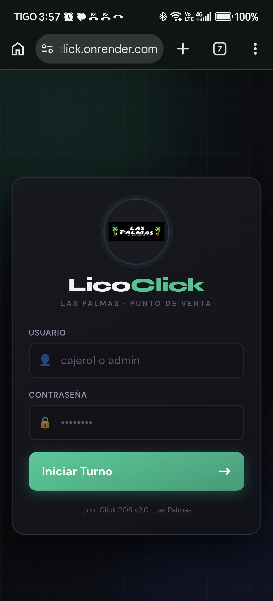
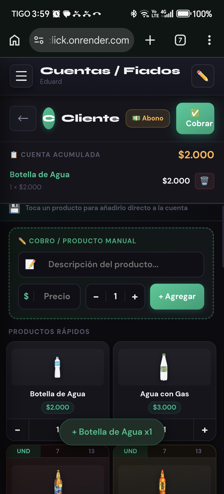
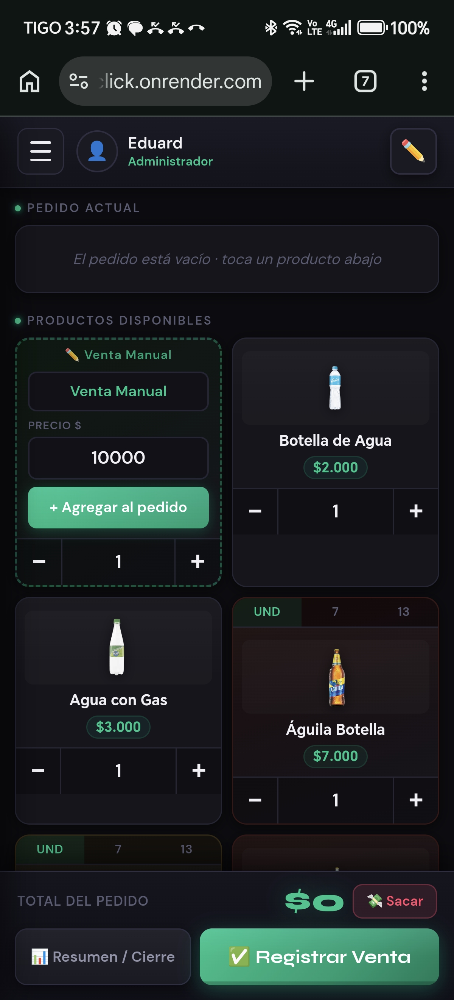

# LicoClick: sistema de punto de venta (POS) web

Aplicación web para registrar ventas, controlar cuentas por cobrar (fiados) y cuadrar la caja por turno en un estanco.

## Contexto

Trabajaba en un estanco donde las ventas y los fiados se llevaban a mano. Vi la necesidad y desarrollé LicoClick por iniciativa propia. Lo usé en la operación real del negocio para registrar las ventas y llevar la cuenta de los fiados.

> **Estado:** el proyecto ya no está en uso y la base de datos de producción fue eliminada. El código queda como portafolio.

## Capturas

| Inicio de sesión | Punto de venta | Resumen del turno |
|---|---|---|
|  |  |  |

## Funcionalidades

- **Punto de venta por botones:** catálogo de más de 25 productos con venta por unidad o por paquete y edición de precios.
- **Turnos manuales:** apertura y cierre de caja por jornada real de trabajo, sin cortes a medianoche (ideal para negocios nocturnos).
- **Fiados (cuentas por cobrar):** registro de clientes, productos a crédito, abonos parciales o totales y saldo actualizado.
- **Retiros de caja:** salidas de dinero y pagos a proveedores que afectan el cuadre final.
- **Cuadre de caja automático:** contrasta ventas, fiados, retiros y efectivo físico, y calcula la diferencia exacta.
- **Diseño responsive:** pensado para operarse desde el celular.

## Tecnologías

- **Frontend:** HTML5, CSS3, JavaScript (vanilla)
- **Backend y base de datos:** [Supabase](https://supabase.com/) (PostgreSQL) mediante su API REST
- **Sesión local:** `localStorage`
- **Control de versiones:** Git y GitHub

## Modelo de datos (Supabase / PostgreSQL)

| Tabla | Uso |
|---|---|
| `usuarios` | Personal que inicia turno (rol cajero o administrador) |
| `ventas` / `venta_items` | Cabecera y detalle de cada venta |
| `fiados` / `fiado_items` | Clientes con crédito y productos fiados |
| `retiros_caja` | Salidas de dinero durante el turno |
| `cierres_caja` | Resultado del cuadre de cada turno |

## Estructura

```
login.html      Inicio de sesión del personal
index.html      Punto de venta (catálogo y carrito)
fiados.html     Gestión de cuentas por cobrar
resumen.html    Resumen y cierre del turno
script.js       Lógica de ventas, fiados, retiros y cuadre de caja
Style.css       Estilos generales
fiados.css      Estilos del módulo de fiados
imagenes/       Imágenes de los productos
```

## Cómo ejecutarlo

1. Crea un proyecto en Supabase con las tablas de arriba.
2. Reemplaza `SUPABASE_URL` y `SUPABASE_KEY` en `script.js` y `login.html` por los de tu proyecto.
3. Abre `login.html` con un servidor local (por ejemplo, la extensión Live Server de VS Code).

## Limitaciones conocidas y próximas mejoras

Las documento porque son lo primero que cambiaría en una versión 2:

- **Autenticación:** el login compara usuario y contraseña directamente contra la tabla `usuarios`. Lo correcto es usar **Supabase Auth** (contraseñas cifradas y sesión con JWT) en lugar de una sesión guardada en `localStorage`.
- **Seguridad de datos:** activar **Row Level Security (RLS)** en todas las tablas, con políticas por rol.
- **Catálogo:** mover los productos y precios a una tabla para que los cambios se sincronicen entre dispositivos (hoy los precios editados se guardan solo en el navegador).
- **Código:** dividir `script.js` en módulos (ventas, fiados, caja).

## Autor

Eduard Mattias Rangel Ramírez · [LinkedIn](https://www.linkedin.com/in/mattias-rangel-8abab0310) · [GitHub](https://github.com/MattiasRangel)
